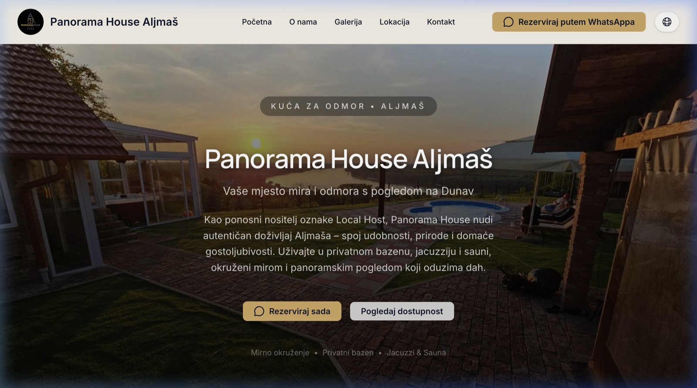

# Panorama House Aljmaš

Website for Panorama House, a holiday house on the Danube in Aljmaš, Croatia. The goal is direct
bookings: guests find the house, see it, and get in touch without going through a booking platform.

**Live:** [panoramahousealjmas.com](https://panoramahousealjmas.com)



## What it does

- Mobile-first one-page home: hero with a WhatsApp booking button, amenities, gallery with a lightbox,
  location with a map, contact preview
- Separate About and Contact pages; the contact form posts to Formspree
- Croatian, English and German, switchable on every page
- SEO basics: Open Graph and Twitter metadata, sitemap, robots, favicon
- Accessibility: aria labels, keyboard navigation and focus states, lazy-loaded images

## Stack

Next.js 15 (App Router, static export), React, TypeScript, Tailwind CSS v4, Heroicons and Lucide.
Content and contact details live in one config file (`lib/site.config.ts`).

## Run it locally

```bash
npm install
npm run dev     # http://localhost:3000
npm run build   # static export into out/
```

Node.js 18 or newer.

---

Built by [Elmir Beširović](https://itselmotech.com/elmir).
